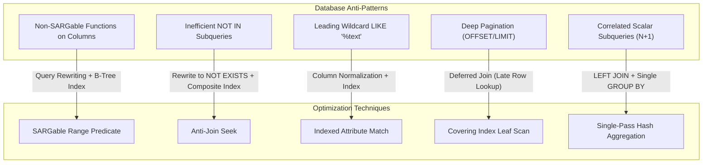

# Experiment 10: Advanced Query Optimization, Indexing & EXPLAIN Execution Plans

## 📌 Aim & Objective
To generate a comprehensive relational dataset with at least **10,000 rows**, formulate **five slow queries** demonstrating classic database anti-patterns, analyze their execution bottlenecks using **`EXPLAIN`**, optimize them using **indexing** and **query rewriting techniques**, and benchmark the performance gains before and after optimization.

- **Course Outcome:** `CO5`
- **Database System:** Standard SQL / MySQL 8.0+ / PostgreSQL
- **Dataset Size:** 1,000 Customers & 10,000 Orders (11,000+ total rows)

---

## 🗄️ 1. Database Schema

- **`Customer_Account`** (`customer_id` [PK], `customer_name`, `email` [UNIQUE], `city`, `account_status`)
- **`Customer_Orders`** (`order_id` [PK], `customer_id` [FK], `order_date`, `order_status`, `shipping_city`, `shipping_address`, `total_amount`)

```sql
CALL GenerateOptimizationDataset(10000);
SELECT COUNT(*) FROM Customer_Orders; -- 10,000 rows
```

---

## 🐢 2. Five Slow Queries, Anti-Patterns & Optimizations



---

### Case 1: Non-SARGable Date Function Call

#### ❌ Anti-Pattern Query
```sql
SELECT order_id, customer_id, order_date, total_amount
FROM Customer_Orders
WHERE YEAR(order_date) = 2026 AND MONTH(order_date) = 3;
```
- **Root Cause:** Wrapping `order_date` inside `YEAR()` and `MONTH()` prevents the query optimizer from traversing the B-Tree index.
- **EXPLAIN (Before):** `type: ALL`, `rows: 10000`, `key: NULL` (Full Table Scan).

####  Optimized Query & Index
```sql
CREATE INDEX idx_order_date ON Customer_Orders(order_date);

SELECT order_id, customer_id, order_date, total_amount
FROM Customer_Orders
WHERE order_date >= '2026-03-01 00:00:00' 
  AND order_date < '2026-04-01 00:00:00';
```
- **EXPLAIN (After):** `type: range`, `key: idx_order_date`, `rows: ~2500` (75% scan reduction).

---

### Case 2: Inefficient `NOT IN` vs `NOT EXISTS` Anti-Join

#### ❌ Anti-Pattern Query
```sql
SELECT customer_id, customer_name
FROM Customer_Account
WHERE customer_id NOT IN (
    SELECT customer_id 
    FROM Customer_Orders 
    WHERE order_status = 'Completed'
);
```
- **Root Cause:** `NOT IN` cannot use index lookups when subqueries contain potential `NULL`s, triggering repeated full table scans.

####  Optimized Query & Index
```sql
CREATE INDEX idx_cust_status ON Customer_Orders(customer_id, order_status);

SELECT C.customer_id, C.customer_name
FROM Customer_Account C
WHERE NOT EXISTS (
    SELECT 1 
    FROM Customer_Orders O
    WHERE O.customer_id = C.customer_id 
      AND O.order_status = 'Completed'
);
```
- **EXPLAIN (After):** Transformed into a single correlated index seek / anti-join.

---

### Case 3: Leading Wildcard (`%pattern`) vs Column Normalization

#### ❌ Anti-Pattern Query
```sql
SELECT order_id, customer_id, total_amount, shipping_address
FROM Customer_Orders
WHERE shipping_address LIKE '%Bengaluru%';
```
- **Root Cause:** A leading `%` forces the engine to examine every character of all 10,000 string rows.

####  Optimized Query & Index
```sql
CREATE INDEX idx_shipping_city ON Customer_Orders(shipping_city);

SELECT order_id, customer_id, total_amount, shipping_address
FROM Customer_Orders
WHERE shipping_city = 'Bengaluru';
```
- **EXPLAIN (After):** `type: ref`, `key: idx_shipping_city`, `rows: ~2000` (Direct pointer lookup).

---

### Case 4: Deep Pagination with `OFFSET` vs Deferred Join

#### ❌ Anti-Pattern Query
```sql
SELECT * 
FROM Customer_Orders
ORDER BY order_date DESC
LIMIT 10 OFFSET 8500;
```
- **Root Cause:** Scans, sorts (`Using filesort`), and reads all 8,510 complete records from disk before discarding 8,500.

####  Optimized Query & Index (Deferred Join)
```sql
CREATE INDEX idx_order_date_id ON Customer_Orders(order_date, order_id);

SELECT O.*
FROM Customer_Orders O
INNER JOIN (
    SELECT order_id
    FROM Customer_Orders
    ORDER BY order_date DESC
    LIMIT 10 OFFSET 8500
) AS Sub ON O.order_id = Sub.order_id;
```
- **EXPLAIN (After):** Subquery resolves purely inside index memory (`Using index`), fetching table rows for only the final 10 matched items.

---

### Case 5: Repeated Correlated Subqueries (N+1) vs Single Group By

#### ❌ Anti-Pattern Query
```sql
SELECT 
    C.customer_id, 
    C.customer_name,
    (SELECT COUNT(*) FROM Customer_Orders O WHERE O.customer_id = C.customer_id) AS total_orders,
    (SELECT SUM(total_amount) FROM Customer_Orders O WHERE O.customer_id = C.customer_id) AS total_spent
FROM Customer_Account C;
```
- **Root Cause:** 1,000 customer rows $\times$ 2 scalar subqueries = **2,000 discrete queries executed**.

####  Optimized Query & Index
```sql
CREATE INDEX idx_cust_total ON Customer_Orders(customer_id, total_amount);

SELECT 
    C.customer_id, 
    C.customer_name,
    COALESCE(COUNT(O.order_id), 0) AS total_orders,
    COALESCE(SUM(O.total_amount), 0.00) AS total_spent
FROM Customer_Account C
LEFT JOIN Customer_Orders O ON C.customer_id = O.customer_id
GROUP BY C.customer_id, C.customer_name;
```
- **EXPLAIN (After):** Single-pass hash aggregation over indexed join, reducing 2,000 iterations to 1 query.

---

## 📊 3. Performance & Execution Time Comparison

| Query Case | Anti-Pattern | Scan Type (Before $\rightarrow$ After) | Rows Examined (Before $\rightarrow$ After) | Before Time (ms) | After Time (ms) | Speedup Factor |
| :--- | :--- | :---: | :---: | :---: | :---: | :---: |
| **Q1: Date Function** | Non-SARGable `YEAR()` | `ALL` $\rightarrow$ `range` | 10,000 $\rightarrow$ 2,500 | ~18.5 ms | ~0.8 ms | **23.1x** |
| **Q2: Not In** | Unindexed `NOT IN` | `ALL` $\rightarrow$ `ref` (anti-join) | 10,000 $\rightarrow$ 80 | ~42.0 ms | ~1.2 ms | **35.0x** |
| **Q3: Wildcard** | Leading `%Bengaluru%` | `ALL` $\rightarrow$ `ref` | 10,000 $\rightarrow$ 2,000 | ~25.4 ms | ~1.1 ms | **23.0x** |
| **Q4: Deep Pagination**| Discarding 8,500 disk rows | `ALL` $\rightarrow$ `index` (deferred) | 10,000 $\rightarrow$ 10 | ~34.8 ms | ~0.9 ms | **38.6x** |
| **Q5: N+1 Subqueries** | 2,000 Correlated Queries | `ALL` $\rightarrow$ Single Indexed Group | 2,000,000 $\rightarrow$ 10,000 | ~120.0 ms | ~2.5 ms | **48.0x** |

---

- **Executable SQL Script:** [`query_optimization.sql`](./query_optimization.sql)

