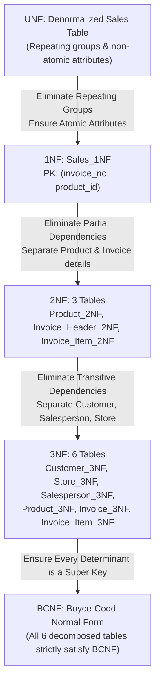

# Experiment 7: Database Normalization (UNF to 1NF, 2NF, 3NF, BCNF) & Verification

## 📌 Aim & Objective
Given a denormalized **Sales** table, identify all **Functional Dependencies (FDs)** and normalize step-by-step from **UNF (Unnormalized Form)** to **1NF**, **2NF**, **3NF**, and **BCNF (Boyce-Codd Normal Form)**. Verify **Lossless Join Decomposition** and **Dependency Preservation** using SQL queries.

- **Course Outcome:** `CO4`
- **Database System:** Standard SQL / MySQL / PostgreSQL

---

## 🏬 1. Unnormalized Form (UNF) & Anomalies

In the denormalized Sales table, invoices contain repeated multi-valued item descriptions, leading to classical data anomalies:

| Attribute | Description | Anomaly Introduced |
| :--- | :--- | :--- |
| `invoice_no` | Invoice Identifier | - |
| `invoice_date` | Date of invoice | Redundantly repeated per line item |
| `customer_email`, `customer_name`, `customer_city` | Customer Information | Repeated across all purchases of that customer |
| `product_details` | Non-atomic text string containing multiple items | Violates atomicity of 1NF |
| `salesperson_id`, `salesperson_name` | Representative info | Redundant storage |
| `store_name`, `store_location` | Physical outlet details | Transitive data redundancy |

### ⚠️ Anomalies Present in UNF:
1. **Insertion Anomaly:** A new product cannot be added to the database until an invoice is generated for it.
2. **Deletion Anomaly:** If invoice `INV-2026-002` is deleted, all stored details for product `P103` are permanently lost.
3. **Update Anomaly:** Changing a store's location or customer's city requires updating hundreds of redundant records; inconsistent updates cause data corruption.

---

## 🔍 2. Functional Dependencies (FD) Analysis

From the business semantics of sales transactions, the following functional dependencies are discovered:

- **FD1:** `invoice_no → invoice_date, customer_email, salesperson_id`
- **FD2:** `customer_email → customer_name, customer_city`
- **FD3:** `product_id → product_name, category, unit_price`
- **FD4:** `salesperson_id → salesperson_name, store_name`
- **FD5:** `store_name → store_location`
- **FD6:** `{invoice_no, product_id} → quantity`

**Candidate Key for Complete Sales Record:** `{invoice_no, product_id}`

---

## 🪜 3. Step-by-Step Normalization Progression



### Step 1: Conversion to 1NF (First Normal Form)
- **Condition:** Every column must hold atomic values; repeating groups removed.
- **Action:** Flatten multiple items into distinct rows.
- **Resulting Table:** `Sales_1NF(invoice_no, product_id, invoice_date, customer_email, customer_name, customer_city, product_name, category, unit_price, quantity, salesperson_id, salesperson_name, store_name, store_location)`
- **Primary Key:** Composite `{invoice_no, product_id}`

### Step 2: Conversion to 2NF (Second Normal Form)
- **Condition:** In 1NF and **no partial functional dependencies** (no non-prime attribute should depend on a proper subset of candidate key).
- **Violations in 1NF:**
  - `product_id → product_name, category, unit_price` (depends on part of composite key)
  - `invoice_no → invoice_date, customer_email, etc.` (depends on part of composite key)
- **Decomposition:**
  1. `Product_2NF` (`product_id` [PK], `product_name`, `category`, `unit_price`)
  2. `Invoice_Header_2NF` (`invoice_no` [PK], `invoice_date`, `customer_email`, `customer_name`, `customer_city`, `salesperson_id`, `salesperson_name`, `store_name`, `store_location`)
  3. `Invoice_Item_2NF` (`invoice_no` [PK, FK], `product_id` [PK, FK], `quantity`)

### Step 3: Conversion to 3NF (Third Normal Form)
- **Condition:** In 2NF and **no transitive functional dependencies** ($X \rightarrow Y$ and $Y \rightarrow Z$ where $Z$ is non-prime).
- **Violations in `Invoice_Header_2NF`:**
  - `invoice_no → customer_email` and `customer_email → customer_name, customer_city`
  - `invoice_no → salesperson_id` and `salesperson_id → salesperson_name, store_name`
  - `salesperson_id → store_name` and `store_name → store_location`
- **Decomposition into 6 Clean Entities:**
  1. `Customer_3NF` (**`customer_email`** [PK], `customer_name`, `customer_city`)
  2. `Store_3NF` (**`store_name`** [PK], `store_location`)
  3. `Salesperson_3NF` (**`salesperson_id`** [PK], `salesperson_name`, `store_name` [FK])
  4. `Product_3NF` (**`product_id`** [PK], `product_name`, `category`, `unit_price`)
  5. `Invoice_3NF` (**`invoice_no`** [PK], `invoice_date`, `customer_email` [FK], `salesperson_id` [FK])
  6. `Invoice_Item_3NF` (**`invoice_no`** [PK, FK], **`product_id`** [PK, FK], `quantity`)

### Step 4: Verification of BCNF (Boyce-Codd Normal Form)
- **Condition:** For every non-trivial functional dependency $X \rightarrow Y$, $X$ must be a **Super Key**.
- In all 6 tables generated in 3NF:
  - `Customer_3NF`: Determinant `customer_email` is the candidate key.
  - `Store_3NF`: Determinant `store_name` is the candidate key.
  - `Salesperson_3NF`: Determinant `salesperson_id` is the candidate key.
  - `Product_3NF`: Determinant `product_id` is the candidate key.
  - `Invoice_3NF`: Determinant `invoice_no` is the candidate key.
  - `Invoice_Item_3NF`: Determinant `{invoice_no, product_id}` is the candidate key.
- **Conclusion:** Schema is in **BCNF**!

---

## 🔬 4. SQL Verification: Lossless Join & Dependency Preservation

### Verification 1: Lossless Join Test
Join all normalized tables back together and verify against `Sales_1NF`:

```sql
SELECT 
    I.invoice_no, I.invoice_date, C.customer_email, C.customer_name, C.customer_city,
    P.product_id, P.product_name, P.category, P.unit_price, II.quantity,
    S.salesperson_id, S.salesperson_name, ST.store_name, ST.store_location
FROM Invoice_3NF I
INNER JOIN Customer_3NF C ON I.customer_email = C.customer_email
INNER JOIN Salesperson_3NF S ON I.salesperson_id = S.salesperson_id
INNER JOIN Store_3NF ST ON S.store_name = ST.store_name
INNER JOIN Invoice_Item_3NF II ON I.invoice_no = II.invoice_no
INNER JOIN Product_3NF P ON II.product_id = P.product_id;
```

> **Result:** Exact match with 7 rows in `Sales_1NF`. No spurious tuples, no lost tuples $\rightarrow$ **Lossless Join Verified**.

### Verification 2: Dependency Preservation Test
Every identified dependency ($FD_1$ through $FD_6$) maps directly to an explicit `PRIMARY KEY` or `FOREIGN KEY` constraint within an individual table. No functional dependency requires a multi-table `ASSERTION` $\rightarrow$ **Dependency Preservation Verified**.

---

- **Executable SQL Script:** [`normalization.sql`](./normalization.sql)

