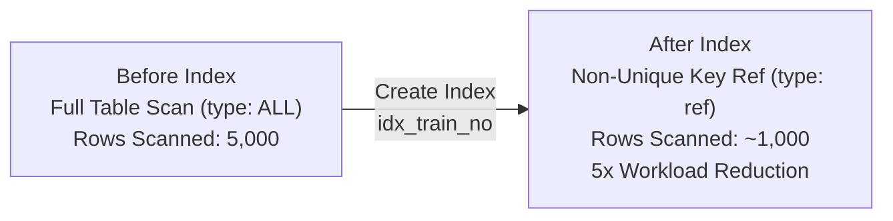

# Experiment 9: Database Indexing, Query Performance Benchmarking & EXPLAIN Analysis

## 📌 Aim & Objective
To create a **Railway Booking** table with at least **5,000 records**, benchmark query execution performance before and after constructing **single-column** and **composite indexes**, and use the **`EXPLAIN`** command to evaluate and compare physical execution plans.

- **Course Outcome:** `CO5`
- **Database System:** Standard SQL / MySQL 8.0+ / PostgreSQL
- **Dataset Size:** 5,000 records generated via stored procedure

---

## 🚆 1. Database Schema (`Railway_Booking`)

```sql
CREATE TABLE Railway_Booking (
    booking_id INT AUTO_INCREMENT PRIMARY KEY,
    pnr_no VARCHAR(12) NOT NULL UNIQUE,
    train_no INT NOT NULL,
    train_name VARCHAR(100) NOT NULL,
    passenger_name VARCHAR(100) NOT NULL,
    passenger_age INT NOT NULL,
    gender VARCHAR(10) NOT NULL,
    source_stn VARCHAR(50) NOT NULL,
    dest_stn VARCHAR(50) NOT NULL,
    journey_date DATE NOT NULL,
    travel_class VARCHAR(10) NOT NULL,
    booking_status VARCHAR(20) NOT NULL,
    fare_amount DECIMAL(10, 2) NOT NULL,
    created_at TIMESTAMP DEFAULT CURRENT_TIMESTAMP
);
```

---

## ⚙️ 2. Data Population Procedure (5,000 Records)

Populated with realistic passenger names, 5 Indian Railways train numbers (e.g. Rajdhani, Shatabdi, Vande Bharat), origin/destination station pairs, travel classes (`1A`, `2A`, `3A`, `SL`), and statuses (`CONFIRMED`, `RAC`, `WAITING`):

```sql
CALL PopulateRailwayBookings(5000);
SELECT COUNT(*) FROM Railway_Booking; -- Output: 5000
```

---

## 📊 3. Benchmarking & Execution Plan Comparisons (`EXPLAIN`)

### Test Case 1: Single-Column Equality Search (`train_no`)

```sql
SELECT booking_id, pnr_no, passenger_name, fare_amount 
FROM Railway_Booking 
WHERE train_no = 12002;
```



- **Before Index:**
  - `type`: `ALL` (Full Table Scan)
  - `key`: `NULL`
  - `rows`: 5,000
- **Index Applied:** `CREATE INDEX idx_train_no ON Railway_Booking(train_no);`
- **After Index:**
  - `type`: `ref` (Direct B-Tree pointer)
  - `key`: `idx_train_no`
  - `rows`: ~1,000

---

### Test Case 2: Range Query on Date (`journey_date`)

```sql
SELECT booking_id, pnr_no, train_no, journey_date, booking_status
FROM Railway_Booking
WHERE journey_date BETWEEN '2026-05-10' AND '2026-05-15';
```

- **Before Index:** `type: ALL`, `rows: 5000`.
- **Index Applied:** `CREATE INDEX idx_journey_date ON Railway_Booking(journey_date);`
- **After Index:** `type: range`, `key: idx_journey_date`, `rows: ~660`.

---

### Test Case 3: Composite Index (Multi-Column Filtering + `ORDER BY`)

```sql
SELECT booking_id, pnr_no, passenger_name, fare_amount
FROM Railway_Booking
WHERE source_stn = 'NDLS' 
  AND dest_stn = 'BCT' 
  AND travel_class = '3A'
ORDER BY journey_date ASC;
```

- **Before Index:**
  - `type`: `ALL`
  - `rows`: 5,000
  - `Extra`: `Using where; Using filesort` ⚠️ *(Heavy disk/RAM sort overhead)*
- **Composite Index Applied:**
  ```sql
  CREATE INDEX idx_route_class_date 
  ON Railway_Booking(source_stn, dest_stn, travel_class, journey_date);
  ```
- **After Composite Index:**
  - `type`: `ref`
  - `key`: `idx_route_class_date`
  - `rows`: ~310
  - `Extra`: `Using index condition`
  - 🚀 **`Using filesort` eliminated:** The B-Tree index maintains pre-sorted keys, avoiding any external sorting pass!

---

### Test Case 4: Covering Index (Index-Only Scan)

```sql
SELECT pnr_no, train_no, journey_date, fare_amount
FROM Railway_Booking
WHERE train_no = 12301;
```

- **Covering Index Applied:**
  ```sql
  CREATE INDEX idx_covering_train
  ON Railway_Booking(train_no, pnr_no, journey_date, fare_amount);
  ```
- **Execution Plan:**
  - `key`: `idx_covering_train`
  - `Extra`: `Using index` ⚡
  - **Zero Data Page Reads:** All requested columns are resolved purely from leaf nodes of the index tree.

---

## 📈 4. Performance Summary Table

| Benchmark Query | Index Type | Scan Type Before | Scan Type After | Rows Examined (Before $\rightarrow$ After) | `Extra` Improvements |
| :--- | :--- | :---: | :---: | :---: | :--- |
| **Q1: Train Lookup** | Single Column (`train_no`) | `ALL` | `ref` | 5,000 $\rightarrow$ 1,000 | Direct pointer lookup |
| **Q2: Date Range** | Single Column (`journey_date`) | `ALL` | `range` | 5,000 $\rightarrow$ 660 | B-Tree range scan |
| **Q3: Route + Sort** | Composite (`source`, `dest`, `class`, `date`) | `ALL` | `ref` | 5,000 $\rightarrow$ 310 | **Eliminated `Using filesort`** |
| **Q4: Train Columns** | Covering Index (4 attributes) | `ALL` / `ref` | `ref` | 5,000 $\rightarrow$ 1,000 | **`Using index` (Index-Only)** |

---

- **Executable SQL Script:** [`indexing_performance.sql`](./indexing_performance.sql)

